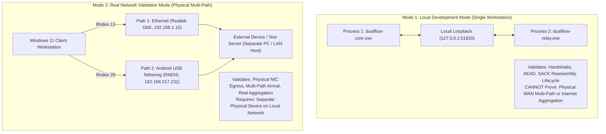
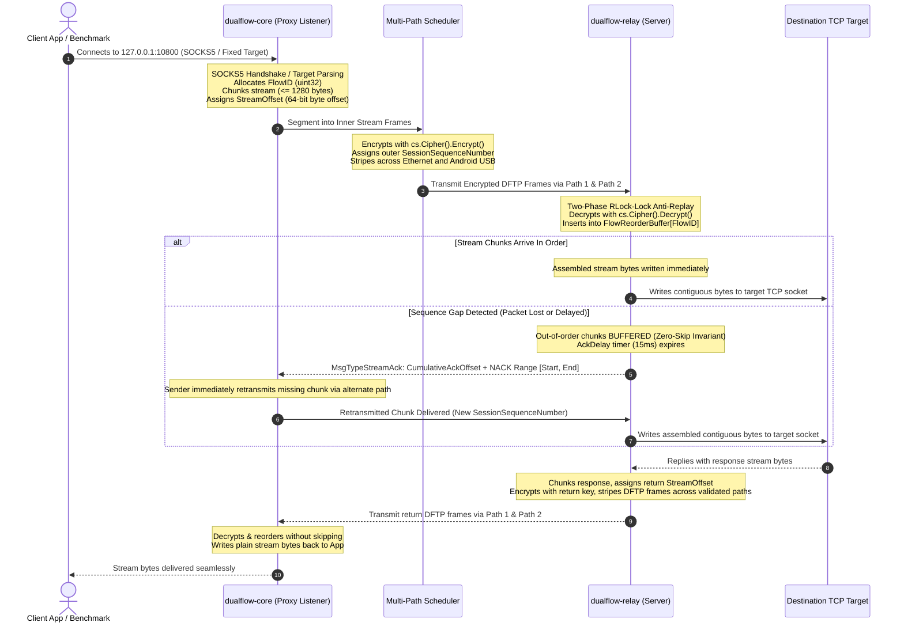
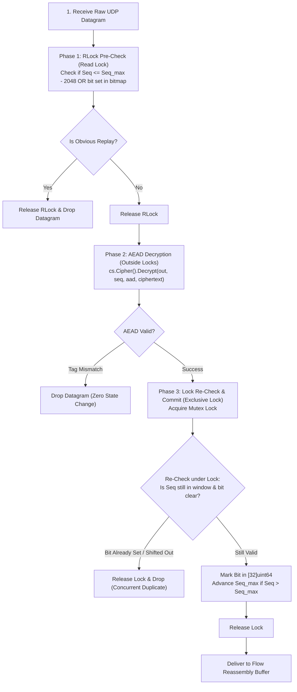
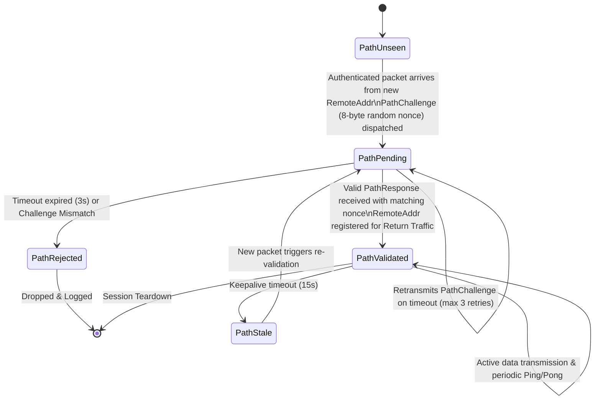

# DualFlow Phase 7 — Architecture Specification v3.0
## Release-Ready Architecture: Local Secure Relay & Real Bonding

**Document Version:** 3.0.0 (Consistency Patched)  
**Status:** Approved Technical Architecture  
**Parent Foundation:** Phases 1–6 Go Network Core & Wintun Integration  
**Primary Engine:** Reliable User-Space Multi-Path TCP Stream Proxy  

---

## 1. Operating Modes: Local Development vs Real Network Validation

DualFlow Phase 7 operates in two strictly partitioned modes to prevent conflating local inter-process communication with physical multi-path transport:



### Mode 1 — Local Development Mode (Default)
- **Host Configuration:** Both client and relay run on the same Windows 11 machine as independent processes.
- **Relay Binding:** Binds strictly to `127.0.0.1:51820` by default. Does not bind to `0.0.0.0` or LAN interfaces without explicit configuration.
- **Scope of Verification:** Protocol correctness, Noise_IKpsk2 state machine, explicit-sequence AEAD encryption/decryption, sequence tracking, 2048-packet anti-replay filtering, zero-skip SACK reassembly buffers, and process lifecycle.
- **Strict Boundary:** **Cannot prove physical multi-path egress or Internet bandwidth aggregation.**

### Mode 2 — Real Network Validation Mode
- **Host Configuration:** Client runs on Windows 11; Relay runs on a separate physical machine (e.g. secondary PC on LAN or local server). No paid VPS required.
- **Network Paths:** Client pins UDP sockets via Winsock `IP_UNICAST_IF` (Ethernet on index 13, Android USB on index 20).
- **Scope of Verification:** True physical WAN egress, independent ingress observation at the remote relay, physical latency divergence handling, cryptographic path validation, and single-flow TCP aggregation benchmarks.

---

## 2. Primary Forwarding Architecture: Reliable User-Space TCP Stream Proxy

To demonstrate single-TCP-flow bandwidth aggregation without requiring kernel NAT or administrative route manipulation on Windows, Phase 7 establishes a **User-Space TCP Stream Proxy**:



---

## 3. TCP Proxy Connection Contract: SOCKS5 & Fixed Target

The Client proxy listener (`127.0.0.1:10800`) accepts connections under two distinct contracts:

### Contract A: SOCKS5 Protocol (RFC 1928) — Standard Client Applications
Standard client applications (e.g. web browsers, `curl`, custom scripts) specify remote destinations via RFC 1928:
1. **SOCKS5 Greeting / Auth Negotiation:**
   - Client App $\to$ DualFlow: `0x05 0x01 0x00` (Version 5, 1 Method, Method = No Authentication).
   - DualFlow $\to$ Client App: `0x05 0x00` (Version 5, No Authentication Required).
2. **SOCKS5 Connection Request:**
   - Client App $\to$ DualFlow: `0x05 0x01 0x00 [ATYP] [DestAddr] [DestPort (2B)]`.
   - Supported Address Types (`ATYP`): IPv4 (`0x01`) and Domain Name (`0x03`). IPv6 (`0x04`) is supported where target relay supports IPv6 routing.
3. **Tunnel Flow Establishment:**
   - DualFlow Client allocates a unique 32-bit `FlowID`.
   - Transmits a `MsgTypeFlowOpen` frame across the bonded tunnel:
     ```
     [FlowID: 4B] || [Port: 2B] || [AddrType: 1B] || [AddrLen: 1B] || [TargetAddress: N bytes]
     ```
   - Relay receives `MsgTypeFlowOpen`, parses target, and calls `net.DialTCP("tcp", nil, targetAddr)`.
4. **Connection Response & Error Handling:**
   - If dial succeeds, Relay returns `MsgTypeFlowOpenAck` (`Status = 0x00`). DualFlow Client replies to Client App with SOCKS5 Success: `0x05 0x00 0x00 0x01 0x00 0x00 0x00 0x00 0x00 0x00`.
   - If dial fails (timeout/refused), Relay returns `MsgTypeFlowOpenAck` with error code (`0x04` Host Unreachable, `0x05` Connection Refused). Client replies to Client App with SOCKS5 failure and closes socket.

### Contract B: Fixed-Destination Mode (`--target <ip:port>`) — Direct Benchmarks
For raw performance benchmarking tools (such as `iperf3 -c 127.0.0.1 -p 10800`):
- DualFlow Client is launched with `--target 192.168.1.50:5201`.
- Any raw TCP connection arriving at `127.0.0.1:10800` automatically opens a bonded flow to the fixed target without requiring SOCKS5 negotiation.
- **Handling Multi-Connection Tools (iperf3):** `iperf3` opens two TCP connections: a Control Connection (exchanging test JSON) and a Data Stream Connection. DualFlow allocates distinct `FlowID`s for each connection (`FlowID = 1` for Control, `FlowID = 2` for Data), isolating the high-throughput bonded stream from control frames.

---

## 4. DFTP v3 Wire Protocol Specification & MTU Calculations

### Definitive MTU Calculations & Byte Budget
DualFlow defines all limits against an **Assumed Path MTU of 1420 bytes** (the standard conservative minimum for cellular 4G/5G LTE and PPPoE networks):

```
+-----------------------------------------------------------------------------------------+
| TOTAL COMPLETE IP PACKET BUDGET (Assumed Path MTU = 1420 Bytes)                         |
|                                                                                         |
| IPv4: [IPv4 Header: 20B] [UDP Header: 8B] [DFTP v3 Frame: 1344B] = 1372 Bytes (<= 1420)  |
| IPv6: [IPv6 Header: 40B] [UDP Header: 8B] [DFTP v3 Frame: 1344B] = 1392 Bytes (<= 1420)  |
+-----------------------------------------------------------------------------------------+
| COMPLETE UDP DATAGRAM BUDGET (Total: 1352 Bytes for both IPv4 and IPv6)                 |
|                                                                                         |
| [UDP Header: 8B] + [DFTP v3 Frame (UDP Payload): 1344B] = 1352 Bytes                    |
+-----------------------------------------------------------------------------------------+
| DFTP v3 FRAME BUDGET (Total: 1344 Bytes)                                                |
|                                                                                         |
| [Outer Header: 32B] [Inner Stream Header: 16B] [Stream Payload Chunk: 1280B] [Tag: 16B]|
| Calculation: 32 + 16 + 1280 + 16 = 1344 Bytes                                           |
+-----------------------------------------------------------------------------------------+
```

| Specification Term | Exact Value (IPv4) | Exact Value (IPv6) | Technical Definition |
|---|---|---|---|
| **Assumed Path MTU** | `1420` bytes | `1420` bytes | Maximum Transmission Unit of bottleneck cellular link. |
| **Complete IP Packet** | `1372` bytes | `1392` bytes | Total packet on physical wire (IP header to payload end). |
| **Complete UDP Datagram** | `1352` bytes | `1352` bytes | UDP header (8B) + UDP payload (1344B). |
| **UDP Payload (DFTP Frame)**| `1344` bytes | `1344` bytes | Outer DFTP header (32B) + Encrypted Payload (1312B). |
| **Outer DFTP Header** | `32` bytes | `32` bytes | Fixed routing, session, sequence, and path identification header. |
| **AEAD Authentication Tag** | `16` bytes | `16` bytes | AES-256-GCM integrity tag appended to ciphertext. |
| **Inner Stream Header** | `16` bytes | `16` bytes | `FlowID` (4B) + `StreamOffset` (8B) + Flags/Len (4B). |
| **Application Stream Chunk**| **`1280` bytes** | **`1280` bytes** | Clean, power-of-two chunk data written to TCP stream. |

> [!NOTE]
> **Fragmentation Avoidance Scope:** Zero fragmentation is guaranteed for all network paths with $\text{Path MTU} \ge 1420\text{ bytes}$. Universal fragmentation avoidance is not claimed for networks with sub-1420 MTU (e.g. nested VPN tunnels with 1280 MTU); such paths require dynamic PMTU clamping.

---

### Outer 32-Byte Header Layout

```
 0                   1                   2                   3
 0 1 2 3 4 5 6 7 8 9 0 1 2 3 4 5 6 7 8 9 0 1 2 3 4 5 6 7 8 9 0 1
+-+-+-+-+-+-+-+-+-+-+-+-+-+-+-+-+-+-+-+-+-+-+-+-+-+-+-+-+-+-+-+-+
|       'D'     |      'F'      |      'T'      |      'P'      |  [00-03] Magic Bytes (ASCII "DFTP")
+-+-+-+-+-+-+-+-+-+-+-+-+-+-+-+-+-+-+-+-+-+-+-+-+-+-+-+-+-+-+-+-+
|    Version    |    MsgType    |             Flags             |  [04-07] Ver (3), MsgType, Flags
+-+-+-+-+-+-+-+-+-+-+-+-+-+-+-+-+-+-+-+-+-+-+-+-+-+-+-+-+-+-+-+-+
|         HeaderLength          |           Reserved            |  [08-11] HeaderLen (uint16=32), Reserved
+-+-+-+-+-+-+-+-+-+-+-+-+-+-+-+-+-+-+-+-+-+-+-+-+-+-+-+-+-+-+-+-+
|                           SessionID                           |  [12-15] 32-bit Random Session ID (Rekey changes SessionID)
+-+-+-+-+-+-+-+-+-+-+-+-+-+-+-+-+-+-+-+-+-+-+-+-+-+-+-+-+-+-+-+-+
|                                                               |  [16-23] Monotonic Session Sequence
|                 SessionSequenceNumber (64 bits)               |
+-+-+-+-+-+-+-+-+-+-+-+-+-+-+-+-+-+-+-+-+-+-+-+-+-+-+-+-+-+-+-+-+
|                         PayloadLength                         |  [24-27] Ciphertext Length + 16B Tag
+-+-+-+-+-+-+-+-+-+-+-+-+-+-+-+-+-+-+-+-+-+-+-+-+-+-+-+-+-+-+-+-+
|            PathID             |           Reserved            |  [28-31] Authenticated Path Identifier
+-+-+-+-+-+-+-+-+-+-+-+-+-+-+-+-+-+-+-+-+-+-+-+-+-+-+-+-+-+-+-+-+
|                                                               |
|         Encrypted Payload Body (AEAD Ciphertext)              |  [32 ... (32 + PayloadLength - 17)]
|                                                               |
+-+-+-+-+-+-+-+-+-+-+-+-+-+-+-+-+-+-+-+-+-+-+-+-+-+-+-+-+-+-+-+-+
|                    GCM Authentication Tag                     |  [(32 + PayloadLength - 16) ...
|                          (16 Bytes)                           |   (32 + PayloadLength - 1)]
+-+-+-+-+-+-+-+-+-+-+-+-+-+-+-+-+-+-+-+-+-+-+-+-+-+-+-+-+-+-+-+-+
```

### Complete Message Types (`MsgType`)

| Code | Constant | Description | Payload Encryption | Header is AAD? |
|---|---|---|---|---|
| `0x01` | `MsgTypeData` | Bonded TCP stream or IP packet chunk | AES-256-GCM | Yes (32 bytes) |
| `0x02` | `MsgTypePing` | Active path RTT measurement probe | AES-256-GCM | Yes (32 bytes) |
| `0x03` | `MsgTypePong` | Probe echo response | AES-256-GCM | Yes (32 bytes) |
| `0x04` | `MsgTypeFlowOpen` | Open destination flow (SOCKS5 connect) | AES-256-GCM | Yes (32 bytes) |
| `0x05` | `MsgTypeClose` | Graceful session termination | AES-256-GCM | Yes (32 bytes) |
| `0x06` | `MsgTypeStreamAck` | SACK / NACK selective retransmission report | AES-256-GCM | Yes (32 bytes) |
| `0x07` | `MsgTypePathChallenge` | Path validation cryptographic challenge | AES-256-GCM | Yes (32 bytes) |
| `0x08` | `MsgTypePathResponse` | Path validation challenge response | AES-256-GCM | Yes (32 bytes) |
| `0x09` | `MsgTypeFlowOpenAck` | Flow open result confirmation | AES-256-GCM | Yes (32 bytes) |
| `0x10` | `MsgTypeHandshakeInit` | Noise_IKpsk2 Message 1 | Noise Internal | No (Handshake framing) |
| `0x11` | `MsgTypeHandshakeResp` | Noise_IKpsk2 Message 2 | Noise Internal | No (Handshake framing) |

---

### Inner Stream Framing Layout (16 Bytes)

Every `MsgTypeData` payload encapsulates an inner 16-byte stream framing header preceding the application stream chunk:

```
 0                   1                   2                   3
 0 1 2 3 4 5 6 7 8 9 0 1 2 3 4 5 6 7 8 9 0 1 2 3 4 5 6 7 8 9 0 1
+-+-+-+-+-+-+-+-+-+-+-+-+-+-+-+-+-+-+-+-+-+-+-+-+-+-+-+-+-+-+-+-+
|                           FlowID                              |  [00-03] 32-bit Logical Flow Identifier
+-+-+-+-+-+-+-+-+-+-+-+-+-+-+-+-+-+-+-+-+-+-+-+-+-+-+-+-+-+-+-+-+
|                                                               |  [04-11] 64-bit Monotonic Stream Byte Offset
|                   StreamOffset (64 bits)                      |          (Byte index in TCP flow)
+-+-+-+-+-+-+-+-+-+-+-+-+-+-+-+-+-+-+-+-+-+-+-+-+-+-+-+-+-+-+-+-+
|          StreamFlags          |         PayloadLength         |  [12-15] Flags (uint16), PayloadLen (uint16 <= 1280)
+-+-+-+-+-+-+-+-+-+-+-+-+-+-+-+-+-+-+-+-+-+-+-+-+-+-+-+-+-+-+-+-+
|                    Stream Data Payload ...                    |  [16 ... (16 + PayloadLength - 1)]
+-+-+-+-+-+-+-+-+-+-+-+-+-+-+-+-+-+-+-+-+-+-+-+-+-+-+-+-+-+-+-+-+
```

#### Stream Flags Bitmask (`StreamFlags`)
| Bit Flag | Mask | Constant | Semantic Function |
|---|---|---|---|
| Bit 0 | `0x0001` | `FlagStreamSYN` | Synchronize stream offset. Set on the initial chunk of a flow (`StreamOffset = 0`). |
| Bit 1 | `0x0002` | `FlagStreamFIN` | Half-close signal for sending direction. Sender has finished transmitting data. |
| Bit 2 | `0x0004` | `FlagStreamRST` | Immediate abort signal. Tears down flow, drops buffers, and resets TCP socket. |
| Bit 3 | `0x0008` | `FlagStreamACK` | Piggybacked acknowledgment indicator. |

---

### Selective Acknowledgment Framing (`MsgTypeStreamAck`)

Explicit flow acknowledgments and loss reports use `MsgTypeStreamAck` (`0x06`):

```
 0                   1                   2                   3
 0 1 2 3 4 5 6 7 8 9 0 1 2 3 4 5 6 7 8 9 0 1 2 3 4 5 6 7 8 9 0 1
+-+-+-+-+-+-+-+-+-+-+-+-+-+-+-+-+-+-+-+-+-+-+-+-+-+-+-+-+-+-+-+-+
|                           FlowID                              |  [00-03] Target Flow Identifier
+-+-+-+-+-+-+-+-+-+-+-+-+-+-+-+-+-+-+-+-+-+-+-+-+-+-+-+-+-+-+-+-+
|                                                               |  [04-11] Highest Contiguous Stream Byte Offset
|               CumulativeAckOffset (64 bits)                   |          Acknowledged (Zero-loss baseline)
+-+-+-+-+-+-+-+-+-+-+-+-+-+-+-+-+-+-+-+-+-+-+-+-+-+-+-+-+-+-+-+-+
|         NumSackBlocks         |           Reserved            |  [12-15] SACK Block Count (0 to 8), Reserved (0x0000)
+-+-+-+-+-+-+-+-+-+-+-+-+-+-+-+-+-+-+-+-+-+-+-+-+-+-+-+-+-+-+-+-+
|                                                               |  [16-23] SACK Block 1 Start Offset
|                    SackBlock1Start (64 bits)                  |
+-+-+-+-+-+-+-+-+-+-+-+-+-+-+-+-+-+-+-+-+-+-+-+-+-+-+-+-+-+-+-+-+
|                                                               |  [24-31] SACK Block 1 End Offset (Exclusive)
|                     SackBlock1End (64 bits)                   |
+-+-+-+-+-+-+-+-+-+-+-+-+-+-+-+-+-+-+-+-+-+-+-+-+-+-+-+-+-+-+-+-+
|                             ...                               |  Up to 8 SACK blocks total (16B per block)
```

### Complete Wire-Level Stream Reliability Specification

To deliver reliable, loss-free, in-order TCP byte stream delivery across divergent multi-path links without stream skipping:

1. **Cumulative ACK Semantics:**
   - `CumulativeAckOffset` is strictly monotonic. It confirms that all stream bytes in $[0, \text{CumulativeAckOffset})$ have been received and contiguously written to the local TCP socket.
   - SACK blocks represent half-open byte ranges $[Start, End)$ that have arrived out-of-order and are currently held in the reorder buffer.
   - Any gap between `CumulativeAckOffset` and `SackBlock1Start`, or between $SackBlock_kEnd$ and $SackBlock_{k+1}Start$, defines an unacknowledged stream gap (NACK).

2. **Sender Buffer Retention & Release:**
   - Transmitted stream chunks are retained in the sender's `FlowRetransmitQueue`.
   - When an ACK arrives with `CumulativeAckOffset`, all queued chunks whose byte range $(Offset + Length) \le \text{CumulativeAckOffset}$ are permanently released from memory.
   - Chunks falling inside reported SACK blocks are flagged as `DeliveredOutOfOrder` to prevent redundant timer retransmissions, but are **not freed** until cumulative ACK advances past them.

3. **Duplicate & Stale ACK Handling:**
   - An incoming ACK with `CumulativeAckOffset < current_cumulative_ack` is discarded as stale.
   - An ACK with `CumulativeAckOffset == current_cumulative_ack` with identical SACK blocks increments the `DuplicateAckCount`.
   - Upon receiving **3 duplicate ACKs** (Fast Retransmit), the sender immediately retransmits the missing chunk starting at `CumulativeAckOffset` across the alternate physical path without waiting for RTO expiration.

4. **Retransmission Backoff & Retry Exhaustion:**
   - DualFlow maintains smoothed RTT ($SRTT$) and RTT variance ($RTTVAR$) per path using RFC 6298:
     $$SRTT \leftarrow (1 - \alpha) \cdot SRTT + \alpha \cdot RTT_{sample} \quad (\alpha = 0.125)$$
     $$RTTVAR \leftarrow (1 - \beta) \cdot RTTVAR + \beta \cdot |SRTT - RTT_{sample}| \quad (\beta = 0.25)$$
     $$RTO = SRTT + \max(G, 4 \times RTTVAR) \quad (\text{clamped: } 200\text{ ms} \le RTO \le 3000\text{ ms})$$
   - On retransmission timeout, $RTO$ undergoes binary exponential backoff: $RTO \leftarrow \min(2 \times RTO, 10\text{s})$.
   - **Retry Exhaustion:** A single missing chunk is retried up to a maximum of **5 times** (or 15 seconds total elapsed time). If unacknowledged after 5 retries, the flow is declared dead: the sender transmits `FlagStreamRST` to the peer, sends TCP RST to the local application socket, and deallocates all flow state.

5. **TCP Half-Close Semantics (RFC 793 / RFC 9293):**
   - When the local TCP client shuts down its write direction (`shutdown(SHUT_WR)` / TCP FIN), DualFlow attaches `FlagStreamFIN` to the final transmitted stream chunk of that flow.
   - The remote Relay receives `FlagStreamFIN`, delivers all preceding bytes to the target TCP socket, and calls `net.TCPConn.CloseWrite()`.
   - The reverse direction (Target $\to$ Relay $\to$ Client) remains fully operational and continues delivering inbound traffic until the target closes its connection.
   - Once the remote target sends TCP FIN, the Relay transmits `FlagStreamFIN` back to the Client.
   - The flow is terminated and enters `FlowStateTimeWait` only when **both** directions have sent and acknowledged `FlagStreamFIN`, or immediately if either endpoint issues `FlagStreamRST`.

6. **Flow ID Lifecycle & Safe ID Reuse:**
   - `FlowID` is an unsigned 32-bit integer allocated monotonically (`atomic.AddUint32(&nextFlowID, 1)`).
   - Upon flow closure or reset, the `FlowID` transitions to `FlowStateTimeWait` for **20 seconds** (matching maximum packet lifetime on divergent cellular paths) before being removed from the flow table.
   - With $2^{32} \approx 4.29 \times 10^9$ flow identifiers and a 20-second quarantine window, ID collision is mathematically impossible under normal operations.

7. **Partial Socket Writes & Backpressure Control:**
   - If the destination TCP socket returns a partial write ($n < \text{len}(data)$) or blocks (`EWOULDBLOCK`/`EAGAIN`), the unwritten slice remains queued at the head of the reassembly buffer.
   - Reassembly queues are strictly bounded by `MaxFlowMemory = 2` MB per flow.
   - When reassembly buffer occupancy reaches 80% (1.6 MB), the receiver sets a backpressure flag on outbound ACKs to instruct the sender to pause scheduling new chunks for this flow.
   - If buffer reaches the 2 MB hard cap, newly arriving out-of-order chunks are dropped. Sender retransmission queues hold unacknowledged chunks, naturally exerting TCP window backpressure to the transmitting application socket.

8. **SessionID Allocation & 32-Bit Collision Analysis:**
   - The outer DFTP header allocates a 32-bit random `SessionID`.
   - By the Birthday Paradox, a 50% collision probability across purely random 32-bit integers occurs at $N \approx 77,163$ active sessions.
   - DualFlow enforces `MaxConcurrentSessions = 256`. At 256 sessions, the collision probability is:
     $$P \approx \frac{N^2}{2 \times 2^{32}} = \frac{256^2}{8.58 \times 10^9} \approx 7.6 \times 10^{-6} \ (0.00076\%)$$
   - The Relay checks active sessions in an $O(1)$ hash map upon `MsgTypeHandshakeInit`. If an unlikely collision occurs, a new random identifier is redrawn before replying. No header redesign is required.

---

## 5. Concurrency-Safe Anti-Replay Architecture

To prevent Go data races while processing packets across concurrent worker goroutines:



### Replay Window Budgeting:
- Window size: **2048 packets** ($32 \times \text{uint64}$ words = 256 bytes memory).
- **Reordering Budget:**
  $$\text{At } 10,000\text{ pps } (100\text{ Mbps}): \Delta t = \frac{2048}{10,000} = 204.8\text{ ms}$$
  $$\text{At } 20,000\text{ pps } (200\text{ Mbps}): \Delta t = \frac{2048}{20,000} = 102.4\text{ ms}$$
- If physical path latency divergence exceeds the reordering budget, delayed packets falling outside the window ($Seq \le Seq_{max} - 2048$) are rejected by design as stale. The zero-skip stream engine retransmits the missing chunk across the faster path via SACK.

---

## 6. Path Validation State Machine (Cryptographic Challenge/Response)



---

## 7. Known Limitations and What Localhost Cannot Prove

> [!CAUTION]
> ### Crucial Operational Notice: Localhost vs Real Network
> 1. **Zero Hardware Media Traversal:** On localhost, Windows routes `127.0.0.1` entirely inside kernel memory (`loopback.sys`). Packets do not traverse Ethernet cables or USB controllers.
> 2. **Artificial Network Idealism:** Local loopback exhibits 0.05 ms latency, zero packet loss, zero jitter, and unlimited bandwidth. Real WAN bonding behavior (mitigating 30+ ms latency divergence between cellular and fiber) cannot be measured over loopback.
> 3. **Bandwidth Aggregation Validity:** Multi-process throughput benchmarks on a single CPU measure RAM bus bandwidth, not network aggregation. True bandwidth bonding is only proven in Real Network Validation Mode.
