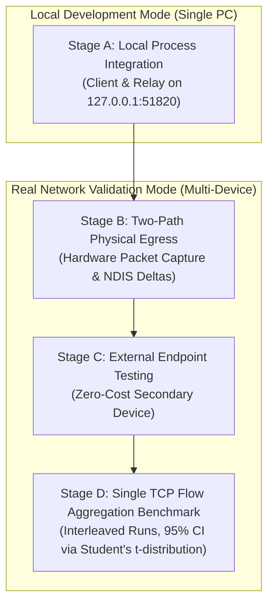

# DualFlow Phase 7 — Test Strategy v3.0
## Multi-Stage Empirical Verification Matrix & Acceptance Contract

**Document Version:** 3.0.0  
**Testing Principle:** Absolute Empirical Honesty — Zero Paid VPS Requirement  
**Boundary Rule:** Localhost tests must never be cited as evidence of physical multi-path egress or Internet aggregation.

---

## 1. Test Architecture & Mode Separation



---

## 2. Shared Source-of-Truth Architectural Parameters

All test stages and assertions are evaluated strictly against the unified framing and transport parameters:

| Parameter Key | Definitive Value | Test Assertion & Verification Criteria |
|---|---|---|
| **Assumed Path MTU** | `1420` bytes | Conservative cellular path MTU limit. |
| **Complete IPv4 Packet** | `1372` bytes | 20B IPv4 + 8B UDP + 1344B DFTP frame $\le 1420$ B. |
| **Complete IPv6 Packet** | `1392` bytes | 40B IPv6 + 8B UDP + 1344B DFTP frame $\le 1420$ B. |
| **Complete UDP Datagram** | `1352` bytes | 8B UDP header + 1344B DFTP frame (identical for IPv4/IPv6). |
| **DFTP Frame (UDP Payload)** | `1344` bytes | 32B outer header + 16B inner header + 1280B chunk + 16B tag. |
| **Stream Chunk Size** | `1280` bytes | Maximum TCP payload per frame. |
| **Noise Protocol Pattern** | `Noise_IKpsk2_25519_AESGCM_SHA256` | Verified via `github.com/flynn/noise v1.1.0`. |
| **AES-GCM Nonce Format** | `[4B 0x00] \|\| [8B seq uint64]` | Verified via upstream `cipherAESGCM` API. |
| **Anti-Replay Window** | `2048` packets (32 words) | Verified under concurrent goroutines with `go test -race`. |
| **SOCKS5 Proxy Listener** | `127.0.0.1:10800` | RFC 1928 compliance verified. |
| **Fixed Target Forwarding** | `--target <ip:port>` | Direct TCP port forwarding verified for `iperf3`. |
| **Statistical Benchmark** | 5 rounds, Randomized / Paired | Paired diff $CI_{lower}(D) > 0$ via Student's t ($t=2.776$), $\ge 15\%$ gain. |

---

## 3. No-Cost External Endpoint Topologies & Reachability Analysis

To validate Phase 7 without purchasing or renting a VPS, the developer can utilize one of the following zero-cost configurations. Each topology is analyzed for dual-path reachability:

| Topology Option | Topology Description | Setup & Reachability Analysis | Validates | Limitations |
|---|---|---|---|---|
| **Option 1: Secondary PC / Laptop on LAN** (Recommended) | A second PC/laptop connected to the home local network (Wi-Fi or Ethernet switch). | **Ethernet Path:** PC routes directly across LAN switch to Laptop LAN IP (`192.168.1.50:51820`).<br/>**Android USB Path:** **CRITICAL TOPOLOGICAL CONSTRAINT:** Android USB tethering commonly routes traffic through cellular WAN and NAT, firewalls local LAN subnets, or drops `192.168.1.0/24` traffic. Do **NOT** assume the phone can reach the LAN PC. Independent pre-test UDP reachability tests must be verified over BOTH interfaces before Stage C can pass.<br/>**Result:** Validates hardware separation if both paths reach the secondary PC. | Full duplex hardware separation, physical Ethernet/Wi-Fi media traversal. | Requires a second physical computer; Android tethering NAT may prevent LAN routing. |
| **Option 2: Android Phone (Self-Relay via Termux)** | The Android phone connected via USB tethering runs the relay binary locally. | **Android USB Path:** Routes directly to Android Gateway (`192.168.217.128:51820`).<br/>**Ethernet Path:** **CRITICAL TOPOLOGICAL CONSTRAINT:** The PC Ethernet (`192.168.1.10`) can reach the phone ONLY if the phone is concurrently connected to the home Wi-Fi network with a reachable LAN IP (e.g. `192.168.1.45:51820`). Pre-test reachability must explicitly confirm both the USB IP and Wi-Fi IP are responding before Stage C. | Physical USB bus ingress on the tethering endpoint. | Requires Termux on Android; phone CPU may throttle under heavy crypto load; Wi-Fi link required for Ethernet path. |
| **Option 3: Bridged Virtual Machine (Hyper-V / VirtualBox)** | A local VM configured with a Bridged Network Adapter on the local network. | **Ethernet Path:** PC reaches VM bridged IP on LAN.<br/>**Android USB Path:** Reaches VM via host virtual switch.<br/>**CRITICAL CONSTRAINT:** A bridged VM shares the host's physical NIC queues. It validates OS network stack isolation, but **does not prove two independent physical WAN uplinks**. | Process and stack isolation without extra hardware. | Not a substitute for true multi-device physical media testing. |
| **Option 4: Honest Local-Only Fallback** | No secondary device is available during the testing session. | Test harness executes Stage A and Stage B, but explicitly halts before Stage C and D. | 100% honest engineering compliance. | Real WAN aggregation remains classified as `NOT TESTED / AWAITING SECOND DEVICE`. |

### Android Cross-Compilation & Termux Compatibility
When targeting an Android phone under Termux (Option 2):
- Build a pure static Go binary with CGO disabled:
  ```powershell
  $env:CGO_ENABLED="0"; $env:GOOS="linux"; $env:GOARCH="arm64"; C:\go\bin\go.exe build -o dualflow-relay-arm64 ./cmd/dualflow-relay
  ```
- *Compatibility Note:* Pure static Linux ARM64 binaries (`GOOS=linux`) execute reliably on 64-bit Android kernels inside the Termux environment without dynamic library dependencies. If compiling with `GOOS=android`, CGO and the Android NDK toolchain (`aarch64-linux-android-clang`) are required. Verify binary compatibility directly by running `./dualflow-relay-arm64 --version` in Termux before testing.
- **Strict Configuration Boundary:** Do not modify Windows host routing tables, DNS, firewall, or NAT settings automatically to force reachability. If an interface cannot route to the relay, document the topological limitation honestly.

---

## 4. Four-Stage Detailed Test Plan

### Stage A — Local Process Integration (Localhost Mode)
- **Target:** `dualflow-core.exe` $\leftrightarrow$ `dualflow-relay.exe` over `127.0.0.1:51820`.
- **Verifications:**
  1. **Process Separation:** Relay and Client launch with independent PIDs; clean startup and shutdown.
  2. **Noise_IKpsk2 Handshake:** `flynn/noise v1.1.0` mutual authentication succeeds within $\le 5\text{ ms}$; both derive identical AES-256-GCM session keys.
  3. **Out-of-Order AEAD Decryption:** Inject frames with non-monotonic sequence arrival (e.g. Seq 1, 3, 2, 5, 4); all frames decrypt successfully and independently using `cs.Cipher().Decrypt(out, seq, ad, ciphertext)`.
  4. **Nonce Uniqueness Unit Test:** Assert zero duplicate nonces across 1,000,000 simulated packets with retransmissions and rekeys.
  5. **Concurrency-Safe Anti-Replay Test:** Execute unit tests with `go test -race` under concurrent goroutines dispatching duplicate packets, delayed packets, and out-of-order arrivals. Assert zero data races.
  6. **SOCKS5 Connection Contract Test:** Test SOCKS5 greeting, connect request, target dial, and SOCKS5 success/failure responses.
  7. **Per-Flow Stream Reassembly:** Injected out-of-order chunks on Flow 1 are buffered and reassembled without skipping; missing chunks trigger SACK; Flow 2 operates completely isolated.
  8. **Graceful Teardown:** Client sends `MsgTypeClose`; Relay cleans session table.
  9. **Framing & MTU Verification:** Assert that transmitted DFTP datagrams are strictly 1352 bytes maximum (32B outer header + 16B inner header + 1280B chunk + 16B tag + 8B UDP header). When wrapped in IPv4 (20B) or IPv6 (40B), total packet size is exactly 1372B or 1392B, strictly below the 1420-byte path MTU.

### Stage B — Two-Path Physical Egress (Hardware Validation)
- **Three-Tier Verification Standard:**
  To prevent treating socket calls or aggregate counters as proof of individual packet transmission, Stage B strictly separates:
  1. **Socket Binding Verification:** `IP_UNICAST_IF` syscall succeeds on interface index 13 and index 20.
  2. **Physical Interface Egress Verification:** Packets physically exit the local miniport.
  3. **Remote Ingress Verification:** Packets are observed arriving at the remote receiving endpoint.
- **Enhanced Methodology:**
  - **Visible DFTP Header Correlation (AEAD Invariant):** Because application payloads and inner flow headers are encrypted with AES-256-GCM, external packet captures (`pktmon`) cannot inspect inner payload bytes or test markers. Packet correlation must rely strictly on **unencrypted, visible outer DFTP header fields**:
    - `SessionID` (bytes 12–15)
    - `SessionSequenceNumber` (bytes 16–23)
    - `PathID` (bytes 28–29)
  - **Per-Packet Client Send Log:** The client test harness maintains an in-memory structured log for every transmitted datagram:
    - `SessionSequenceNumber` (uint64)
    - `PathID` (uint16)
    - `InterfaceIndex` (uint32)
    - `LocalSourceIP` (IP string)
    - `DestinationIP:DestinationPort` (string)
    - `SendTimestamp` (int64 nanoseconds)
  - **Interface-Specific Capture Correlation:** Run `pktmon` bound specifically to Interface 13 (`Ethernet`) and Interface 20 (`Ethernet 3`). Parse captured UDP datagrams on port 51820 for outer DFTP header fields. Correlate 1-to-1: every packet logged as sent via Interface 13 must appear in Interface 13's `pktmon` capture with matching `SessionSequenceNumber` and `PathID == 1`, with zero presence in Interface 20's capture. Vice versa for Interface 20 (`PathID == 2`).
  - **Kernel NDIS Counter Snapshots:** Take `Get-NetAdapterStatistics` snapshots immediately before and after the burst as **supporting aggregate evidence**, NOT as independent proof of an individual packet's egress.
  - **Cross-Leakage Check:** Verifies that packets dispatched to Path 2 do **not** appear on Path 1 capture or NDIS counters.

### Stage C — External Endpoint Testing (Multi-Device Validation)
- **Target:** Relay hosted on an external device (Option 1 or Option 2).
- **Verifications:**
  1. Both physical paths (Ethernet and Android USB) independently reach the external relay.
  2. The Relay observes two distinct remote source `IP:Port` tuples and executes `MsgTypePathChallenge`.
  3. Both endpoints successfully transition to `PathStateValidated`.
- **Honest Fallback:** If a secondary physical device is unavailable, this stage is formally marked:
  ```text
  STATUS: NOT TESTED — AWAITING SECOND DEVICE
  ```

### Stage D — Single TCP Flow Aggregation Benchmark

To eliminate statistical fluke or single-run variance, Stage D executes a **repeatable, multi-run scientific benchmark**:

#### 1. iperf3 Dual-Connection Architecture & Isolation
Even when executed with `-P 1` (single data stream), `iperf3` establishes **two separate TCP connections**:
- **Control Connection (`FlowID = 1`):** Exchanges test parameters, JSON configuration, and final metrics. Low bandwidth, sensitive to disruption.
- **Data Stream Connection (`FlowID = 2`):** Carries the sustained high-throughput benchmark stream.
DualFlow proxies both streams concurrently, isolating their TCP states into separate `FlowID` reassembly buffers. The data stream (`FlowID = 2`) is scheduled across both physical interfaces (Ethernet and Android USB), while the control stream flows reliably without head-of-line blocking from data reassembly.

#### 2. Counterbalanced / Randomized Measurement Protocol
To eliminate temporal bias, warming effects, and carrier time-of-day drift, the order of conditions is **counterbalanced or randomized across 5 rounds**:
```text
Round 1: [Baseline Eth]     -> [Baseline Android] -> [Bonded DualFlow]
Round 2: [Bonded DualFlow]  -> [Baseline Eth]     -> [Baseline Android]
Round 3: [Baseline Android] -> [Bonded DualFlow]  -> [Baseline Eth]
Round 4: [Baseline Eth]     -> [Bonded DualFlow]  -> [Baseline Android]
Round 5: [Bonded DualFlow]  -> [Baseline Android] -> [Baseline Eth]
```
- **Total Executions:** 15 individual test runs (5 rounds $\times$ 3 conditions).
- **Test Invariant:** Exactly identical remote destination, payload size, duration, and socket buffer settings across all conditions.
- **Duration per Run:** 10 seconds total.
- **Warm-Up Period:** The first 2 seconds (TCP slow-start) are discarded; only the steady-state 8 seconds are measured.
- **Cooldown Pause:** 5 seconds between runs to allow socket buffers and queues to fully drain.

#### 3. Metrics Collected per Run:
- Steady-state throughput ($T$, in Mbps).
- Round-Trip Time (RTT) and RTT divergence ($\Delta RTT = |RTT_{eth} - RTT_{and}|$).
- Reorder Buffer Overhead:
  $$O_{reorder} = \frac{\text{Segments Buffered in Reassembly}}{\text{Total Segments Received}} \times 100\%$$
- CPU and RAM utilization of both Client and Relay processes.

#### 4. Paired Difference & Student's t 95% Confidence Interval
For each round $i \in \{1, 2, 3, 4, 5\}$, calculate the **paired performance difference** $D_i$ against the faster individual baseline of that specific round:
$$D_i = T_{bonded, i} - \max(T_{ethernet, i}, T_{android, i})$$

From the 5 paired differences $D_1, \dots, D_5$, compute:
- Sample Mean Paired Difference:
  $$\bar{D} = \frac{1}{5} \sum_{i=1}^5 D_i$$
- Sample Standard Deviation of Paired Differences:
  $$s_D = \sqrt{\frac{1}{4} \sum_{i=1}^5 (D_i - \bar{D})^2}$$

For $N = 5$ rounds ($df = 4$ degrees of freedom), the two-tailed critical value for $\alpha = 0.05$ (95% confidence) is $t_{0.025, 4} = 2.776$.
The 95% Confidence Interval for the mean paired difference is:
$$CI_{95\%}(D) = \bar{D} \pm 2.776 \cdot \frac{s_D}{\sqrt{5}}$$
where:
$$CI_{lower}(D) = \bar{D} - 2.776 \cdot \frac{s_D}{\sqrt{5}}$$

> [!NOTE]
> **Statistical Methodology Notice:** Do NOT evaluate independent confidence intervals ($CI_{bonded}$ vs $CI_{baseline}$) as a direct statistical test of aggregation. Comparing two independent CIs is overly conservative and statistically flawed for repeated paired rounds because it fails to account for inter-round correlation and time-of-day network drift. The paired difference metric $D_i$ isolates bonding performance from external drift and provides the mathematically rigorous test.

#### 5. Strict Dual Pass/Fail Criteria
For the aggregation benchmark to be declared a **PASS**, two mathematical conditions must hold simultaneously:
1. **Paired Difference Statistically Greater than Zero:**
   $$CI_{lower}(D) > 0$$
   (The lower bound of the 95% confidence interval for the paired difference must strictly exceed zero, mathematically proving that bonded throughput exceeds the faster baseline beyond chance).
2. **Minimum 15% Substantive Throughput Gain:**
   $$\bar{T}_{bonded} \ge 1.15 \times \max(\bar{T}_{eth}, \bar{T}_{and})$$
   (The overall mean bonded throughput must be at least 15% higher than the faster single-path baseline).

If either condition is not met, the benchmark is formally classified as:
```text
STATUS: INCONCLUSIVE / AGGREGATION NOT ACHIEVED
```
and the bottleneck root cause (e.g. latency divergence, cellular packet loss, or CPU scheduling) must be documented in the audit log.

---

## 5. Formal Acceptance Criteria

Completion is divided into seven strict, unmerged categories:

| Status Milestone | Scope | Pass Criteria |
|---|---|---|
| **1. Local Process Verified** | Localhost | Client and Relay run as independent processes with distinct PIDs. |
| **2. Local Protocol Verified** | Localhost | DFTP v3 32-byte header, inner stream framing, SACK framing, and validation order verified. |
| **3. Local Cryptography Verified** | Localhost | `flynn/noise v1.1.0` mutual auth, explicit-sequence `cs.Cipher()` AEAD, and RLock-Lock replay commit verified. |
| **4. Local Reassembly Verified** | Localhost | Out-of-order stream chunks correctly reassembled per flow with zero stream skipping; SACK retransmits missing chunks. |
| **5. Physical Egress Verified** | Physical HW | Packet capture (`pktmon`) and NDIS stats show independent packet egress through Ethernet and Android USB with zero cross-leakage. |
| **6. Remote Relay Verified** | Multi-Device| Relay running on a separate physical machine observes independent path ingress; path challenge succeeds. |
| **7. Real TCP Flow Aggregation Verified** | Multi-Device| Single TCP flow achieves steady-state throughput at least 15% higher than both individual paths across 5 runs. |

> [!IMPORTANT]
> A successful result in Milestones 1–4 **must never be reported as proof of Milestones 5–7**.

---

## 6. Known Limitations and What Localhost Cannot Prove

> [!WARNING]
> ### Crucial Limitations of Localhost Testing
> 1. **No Physical Transmission:** Localhost packets remain entirely inside Windows kernel memory (`loopback.sys`). They do not exercise network interface cards, PHY chips, Ethernet cables, or USB controllers.
> 2. **Zero Media Divergence:** Local loopback latency is $< 0.1\text{ ms}$ with zero packet loss. It cannot test how the reassembly engine responds when an LTE cellular tower spikes from 40 ms to 120 ms while Ethernet remains at 15 ms.
> 3. **Throughput Is Memory-Bound:** Localhost bandwidth tests measure RAM memory copying throughput (often $> 10\text{ Gbps}$), bearing zero correlation to real-world Internet WAN bonding.
> 4. **No Middlebox / NAT Interaction:** Localhost tests cannot evaluate cellular CGNAT port timeouts, asymmetric routing, or stateful firewall UDP dropping.
